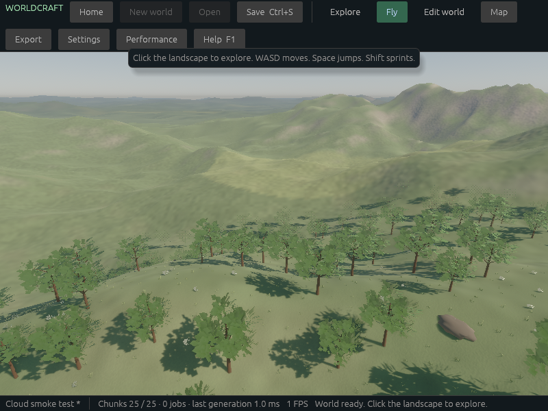
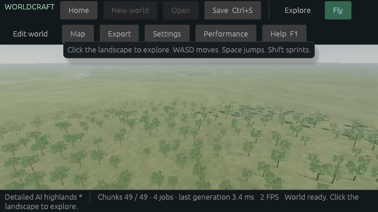

# Adaptive renderer audit

## Wooded ridges and frame pacing · 2026-11-18

The seed-42 woodland now keeps distinct crowns on distant slopes. Each distant tree uses two triangles. Five species share one mipmapped atlas with three profiles per species. The full trunk and crown meshes end by 480 m, while the silhouettes taper between 1,280 and 1,536 m. A stand beyond the exact streamed tiles uses the terrain's cover and a 128 m climate grid. The set of trees and their species can change as the exact tile streams in. The close view still shows repeated leaf and grass shapes.

[Matched two-tile woodland views](media/skyline/WorldCraft-woodland-comparison.jpg) · [Matched six-tile woodland views](media/skyline/WorldCraft-wide-woodland.jpg) · [Six native biome views](media/skyline/WorldCraft-biomes.jpg) · [Native 4K alpine forest](media/skyline/WorldCraft-alpine-4k.jpg) · [Coast and alpine images](media/skyline/WorldCraft-coast-and-alpine.jpg) · [Original material captures](https://github.com/InduwaraLasindu/Worldcraft/actions/runs/44347632614/artifacts/14448082820) · [Original CI forest captures](https://github.com/InduwaraLasindu/Worldcraft/actions/runs/44347632614/artifacts/14450330620)

The 3840 × 2160 alpine still uses the seed-324 untouched biome at full render scale. The timings below come from a separate seed-42 flight at 960 × 640.

### Moving frame times

Both builds flew 156 m in 78 two-metre steps away from the same natural tree. The camera, sun, cloud settings and 960 × 640 image matched on Mesa llvmpipe Vulkan. High quality ran with the interactive limiter and adaptive controller bypassed. Frame times include streaming while moving. Pauses for screenshots are excluded. Each cell below is milliseconds. Lower is faster.

| View radius and build | Median | 95th percentile | 99th percentile |
|---|---:|---:|---:|
| Two tiles · alpha.7 | 1,008.3 | 1,118.5 | 1,153.7 |
| Two tiles · forest update | 1,021.1 | 1,146.9 | 1,182.0 |
| Six tiles · alpha.7 | 3,065.1 | 3,484.2 | 3,621.0 |
| Six tiles · forest update | 2,118.6 | 2,530.0 | 2,578.3 |

On the short route the 95th-percentile frame was 2.5% longer. Both builds retained full trees to 224 m there. At six tiles it was 27.4% shorter. The wider route used the standard manual view radius, 169 resident terrain tiles and at most four chunk jobs in flight. Each row comes from one software-rendered flight. Physical GPU frame rates, VRAM use, and sustained play with the interactive frame target still need measurement.

At the first six-tile viewpoint, the number of resident trunk and crown entities dropped from 35,642 to 20,506. The full tree geometry within its distance range fell from 16,098,994 to 8,321,384 triangles before frustum culling. The streamed tiles also held 7,683 two-triangle silhouettes before distance and view culling. Distant clipmap sectors, shadows and other passes are outside these geometry counts.

Interactive Automatic quality now accepts a 15–120 FPS target and respects Maximum FPS, the monitor refresh rate with V-sync, and memory pressure. The limiter includes rendering and presentation between deadlines. Streaming reuses tile plans during movement that leaves the needed terrain levels unchanged.

Product `8972f0439b5039e31c65b7d674ec24523895fa19` passed 125 Rust tests and six untouched-biome native image checks in the hosted Linux run. The comparison base `2920fa24795363a479c33d6b57f738bd521d42a0` contains the alpha.7 product and its published evidence. The baseline received the same audit timer. The wider fixture changes the radius and endpoint capture gates on both revisions. The [alpha.7 fixture patch](evidence/forest-wide-alpha7.patch) and [candidate fixture patch](evidence/forest-wide-candidate.patch) reproduce the measured routes on their respective checkouts.

The downloaded Windows archive matched its published digest. The installer and portable ZIP each matched the enclosed SHA-256 manifest. The portable executable has an x64 Windows PE header.

[Individual frame intervals, capture hashes and geometry counts](evidence/forest-skyline.json) · [Windows candidate build](https://github.com/InduwaraLasindu/Worldcraft/actions/runs/44347632614/artifacts/14449645006) · [Cross-platform build and checks](https://github.com/InduwaraLasindu/Worldcraft/actions/runs/44347632614)

## Earlier adaptive-renderer audit · 2026-11-16

Engineering alpha; no completed cinematic-engine or universal-FPS claim.
Branch: `codex/worldcraft-adaptive-quality`, draft PR #4 based on resource-budget PR #3.
Executable source: `094ecd1b3c14ceee2110f1269c359c8700cf13b2`.
[Final run 43923268904](https://github.com/InduwaraLasindu/Worldcraft/actions/runs/43923268904).
Both native jobs passed. Linux used the strict renderer log gate; Windows logs were
also inspected and contained no hard shader/pipeline errors. Package bytes were verified.
Documentation-only commits do not change executable bytes or restart native CI.

## 1. Current evidence

| Check | Result | Scope |
|---|---|---|
| Rust core | 27 unit + 28 integration passed | Determinism, legacy worlds/edits, geometry, continuous parent normals/colours, negative coordinates, near/horizon joins |
| Rust ML | 9 passed | Existing native model/generation policies |
| Rust desktop | 18 passed | Automatic/manual/pressure policies, independent vegetation refresh, camera lifecycle, editing/storage, all 12 crown endpoints and conservative target bounds |
| Native-log harness | 4 tests passed | Actual subprocesses: clean success, zero-exit shader/pipeline errors, nonzero exit and recovered library warnings |
| Formatting/API checks | Passed | Locked desktop/all-target check; clippy has existing style warnings and constant-chunk suggestions in test code |
| Final Linux job | Passed | Native model inference, calibration/culling, Eco/Auto, idle metrics, general scene/movement/quality/world/rebase checks, real ray dispatch/cleanup, saved learned world |
| Final Linux hard renderer errors | None | All native commands, including child ray/learned checks, tee through the error-rejecting log gate |
| Final Windows job | Passed | Release build/tests, four harness tests, native inference, launch/culling, distribution and portable detailed world; actual capture/logs reviewed |
| Real gaming-GPU FPS / VRAM | Unmeasured | Software Vulkan/WARP checks do not certify a 30 FPS gaming target |

82 Rust tests plus four separate Python harness tests pass. They are not all GUI interaction
tests. Physical mouse/DPI and temporal travel routes remain open below.

## 2. Actual final Linux measurements

[Raw measurements and provenance](evidence/adaptive-final-linux.json) record the source,
run, artifact, archive checksum and image hash. Hosted Mesa llvmpipe/Vulkan is software rendering.

| Measurement | Observed value |
|---|---:|
| Probe warmup frames | 8 |
| Total probe / measurement time | 3.97 s / 2.31 s |
| Post-warmup samples | 102 |
| Fixture resolution | 256 × 144 |
| Fixture p90 interval | 10.97 ms |
| CPU terrain sample | 7.48 ms |
| Front visible / rear culled | true / true |
| Selected software tier | 0 |
| Real automatic scene / UI dimensions | 400 × 300 / 800 × 600 |
| Auto resident chunks / active jobs | 25 / 0 |
| Saved-world round trip unchanged | true |
| Scaled cursor projection round trip | passed at three window positions |
| Matching crown pairs / ground batches | 869 / 144 |
| Completed software ray GPU dispatch | 497.70 ms |
| Returning to raster released ray work | passed |
| Idle process sample duration | 10.01 s |
| Idle CPU, logical cores used | 0.03797 (about 3.8% of one core) |
| Idle resident memory | 331,464 KiB (about 323.7 MiB) |
| Home world camera active | false |

These are single-fixture process measurements. There is no measured before/after on the
owner's PC, no hard allocator/VRAM/CPU-percent cap and no broad hardware certification.
The full software world did not meet 30 FPS; its small fixture cannot predict complex-world
performance. Automatic's minimum-quality warning is required, not an invented success claim.

## 3. Visual review

This is actual engine output. It is not a reference image or an image-generated substitute.
The reference-quality gap remains large: terrain/material richness, dense natural forests,
connected water, snow/weather and cinematic composition need the remaining milestones.

The earlier 4×4 crown crossfade made obvious patterned holes and generic cone silhouettes.
Crown quality now changes geometrically over 64 m: surplus cards collapse to zero area and
retained cards grow into a species-specific reduced mesh. Every nondegenerate endpoint
triangle is checked for all 12 family/variant meshes. The topology switch uses that same
endpoint without crown alpha dithering. Forward/depth/shadow passes share the observer.
Two unindexed bounding vertices keep target positions inside the mesh's frustum bounds.

Outer nature and ground still use distance dithering. At small view radii its pattern can
remain visible, especially at 50% resolution. Eco disables far terrain; its short draw boundary
is visible from high viewpoints. These are explicit remaining visual limits. A cheap sky/fog
fallback and longer-distance forest representations need further work, not a 'seamless world'
claim. Still images and endpoint tests do not certify every moving-camera transition.

[Windows checkpoint](evidence/adaptive-windows-atmosphere.json) preserves source 19f73ac's
passed native package/calibration/detailed-world proof and actual 640×360 capture. That
checkpoint predates later crown/shader changes and does not substitute for the final run.

[Final Windows provenance](evidence/adaptive-final-windows.json) records the same executable
source, artifact checksum, calibration, detailed-world round trip and verified portable/installer
checksums. The Windows probe yielded nine intervals (p90 301.62 ms at 256×144); this sparse
software result is deliberately labelled limited and selects tier 0. The native package
rendered 49 chunks and 137,910 far triangles, with a 320×320 saved detail field at 30 m spacing.

## 4. Bugs found and corrected during this iteration

| Finding | Correction | Evidence |
|---|---|---|
| Budget changes removed all tiles before replacement | Keep each old tile until its replacement is ready | Native mode/world checks; outside-radius eviction remains bounded |
| Vegetation kept distant detail while terrain key stayed unchanged | Independent vegetation detail identity and stale-result checks | Unit regression plus native move-out/back with the same terrain key |
| Whole-tile ground geometry blocked the main thread and had loose bounds | Worker-built anchored 32 m batches | Native output, high-altitude/negative-coordinate placement invariant |
| 29 FPS counted as meeting 30 | Two-percent budget tolerance and a floor warning | Sustained-29-FPS controller regression |
| Early world entry could bypass the software floor | Enforce software tier/ceiling during real adapter initialization | Native Auto floor and skipped-probe policy |
| Cold shader compilation consumed the probe interval | At least one second/eight frames warmup, two-second measurement, eight-second cutoff | Final measured timings/sample count; sparse results labelled limited |
| UI camera visited world visibility data | Reserve UI layer 30; probe layer 31 | Home/fixture checks; world remains layer 0 |
| Wrong camera could control shadow detail | Explicit world-camera ShadowLodOrigin | Native foliage/scene audit |
| Inactive atmosphere probe had no transform uniform | Reconcile atmosphere/Bloom/SSAO/fog with camera activation | ECS lifecycle regression and passed Windows detailed-world checkpoint |
| Standalone ray test had no world and its camera was disabled | Explicit private ray-fixture activation | Lifecycle regression and observed GPU dispatch/raster cleanup |
| Crown dithering looked visibly worse despite green structure tests | Species-specific geometric endpoint morph | 12-variant triangle/bounds test and native image review |
| Ray job could be green with a material shader validation error | Gate previous-world output on PREPASS_PIPELINE and MOTION_VECTOR_PREPASS; reject hard native log errors | Final strict Linux job contains no hard errors; four harness regressions |
| Optional publisher expected absent GH_TOKEN | Skip optional publication without credentials; preserve artifacts | Later Windows jobs passed |
| Two PowerShell helpers reused one C# type | Give the detailed helper its own type name | Later sequential packaging jobs passed |

## 5. Historical evidence and rejected experiments

- c24a509 / run 43890874327: first Linux job and Windows normal scenes completed. Windows
  then failed on optional GH_TOKEN publication. Initial probe produced one slow cold-start
  interval; conservative classification was deliberate. Earlier captures/metrics are retained
  in evidence/adaptive-linux-initial.json and media/adaptive-linux-high.png/home.png.
- b98a9ee / run 43897987803: capped probe, explicit frustum witnesses and actual 50% Auto
  scene passed Linux. Windows later hit the duplicate C# helper. Hardened measurements are
  in evidence/adaptive-linux-hardened.json.
- bbd15f5 / run 43904948988 and 91bbc5d / run 43908954326: the portable detailed example
  exposed the inactive-atmosphere startup panic, later fixed.
- 19f73ac / run 43910662273: Windows fully passed; Linux exposed the inactive standalone
  ray-fixture camera. The native Windows screenshot/provenance is retained separately.
- 3825064 / run 43914284894: both jobs returned success under the older harness. Visual
  review rejected crown checkerboarding. Measurements remain in
  evidence/adaptive-linux-verified-checkpoint.json. This is not strict material certification.
- 8912538 / run 43919878032: geometric crowns improved the raster image, but manual Linux
  log review found invalid previous_world_position writes in a forward shader variant while
  a Solari dispatch still completed. That false-green audit led to the shader/gate corrections.
- A local no-display SwiftShader experiment produced pixels but hung at teardown; its
  temporary route was removed. It is not counted as a passing native audit.

Bevy can briefly log unresolved embedded-library imports while loading asynchronously.
Those recoverable warnings are distinct from hard shader/pipeline validation failures.
The final gate rejects the latter even if the application continues and exits zero.

## 6. Remaining acceptance work

1. Native CI and package verification are complete for source 094ecd1. Keep the alpha
   label and do not promote this to broad hardware, interaction or cinematic certification.
2. Capture deliberate routes across every terrain/crown threshold and near/horizon join,
   including negative coordinates, rapid flight, late refinement, radius/budget changes
   and rebases. Do not infer temporal perfection from static endpoint equality.
3. Improve low-budget horizon/sky/fog treatment and outer foliage fading; add appropriate
   distant forest representations. Larger view radii hide some current artifacts but are
   not a low-end solution by themselves.
4. Verify physical mouse painting/undo at 50/67/85/100% scene scale and several desktop
   DPIs. Native three-point projection checks passed; physical event delivery is separate.
5. Measure 32 m batch draw overhead, crown prototype/entity costs and fine terrain bands
   on real Windows integrated/discrete GPUs. Keep compatibility/endpoint tests intact.
6. Inspect morphed raster geometry versus static secondary-ray proxies, including deferred
   morph variants and actual hardware rays. No deformation-aware ray-scene certification yet.
7. Continue ENGINE_PLAN.md and NEXT_ENGINE_TASKS.md: connected hydrology, hydraulic
   erosion, richer ecology/materials/snow/weather, native ray-based audio and authoring.

Keep alpha labeling. The cinematic reference target and master specification are unfinished.
