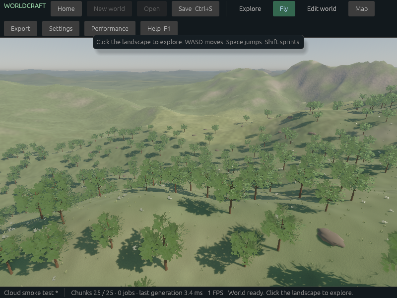
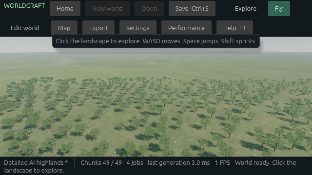

# Adaptive renderer audit

Updated 2026-11-16. Branch: `codex/worldcraft-adaptive-quality`. PR: #4, based on #3.
Status: engineering alpha candidate; not published or certified as the completed engine.
Verified checkpoint executable source: `3825064850fcd00a06d0e0518d88fdd4bef25443`,
[run 43914284894](https://github.com/InduwaraLasindu/Worldcraft/actions/runs/43914284894), both OS jobs passed.
Later documentation-only commits do not change executable source or restart native CI.

## 1. Evidence ledger

The first hosted snapshot is commit `c24a5098ba2cfe84c5e72887288cbfa873fb641c`, run
[43890874327](https://github.com/InduwaraLasindu/Worldcraft/actions/runs/43890874327).
Later hardening is distinguished below; results never automatically transfer to newer code.

| Check | Result | Exact scope |
|---|---|---|
| Latest local core + ML | Passed: 27 core unit + 28 world integration + 9 ML unit | Includes classifier/governor, parent grid/normal/color endpoints, negative coordinates and horizon joins across radii/observer offsets |
| Latest local desktop | Passed: 18 tests | Auto/manual/pressure policy, saved-world compatibility, collisions, editing and storage |
| Latest desktop API/all targets | Passed, ci profile | Native Rust/Bevy API compile; GPU shader compilation is a separate runtime check |
| First hosted Linux snapshot | Entire job passed | Native model inference, launch probe, Eco scene, idle process metrics, regular rendering, rebase/quality/world changes and captures |
| First hosted Windows snapshot | Compile/tests/native inference/rendering/image checks passed | Release executable, installer/portable preparation, WARP DX12 at 128×96; all eight image-variation checks completed |
| First Windows workflow final result | Failed after rendering | Optional evidence publisher required absent GH_TOKEN. Current script skips optional publication without credentials; artifacts remain uploaded |
| Windows packaged detailed example | Failed; lifecycle fix awaiting native rerun | Run 43904948988 reached the portable example and exposed an atmosphere-probe panic while the main camera was inactive |
| Hardened snapshot b98a9ee, Linux | Entire job passed, run 43897987803 | Explicit frustum witnesses, capped probe, software-tier floor, 50% automatic scene route and saved-world equality |
| Hardened snapshot b98a9ee, Windows | Compile/tests/inference/calibration/full scene checks passed; packaging failed | Sequential helper scripts reused a C# type name; corrected in bbd15f5 |
| Snapshot bbd15f5 | Linux passed; Windows portable example failed, run 43904948988 | Bevy atmosphere environment transform buffer was absent while the world camera was inactive |
| Snapshot 91bbc5d | Linux passed; Windows detailed package failed, run 43908954326 | Independent vegetation refresh passed; the same inactive atmosphere-view startup failure remained |
| Atmosphere fix 19f73ac | Linux normal scenes passed, ray fixture failed; Windows fully passed, run 43910662273 | Standalone ray fixture had no saved world, so the budget system incorrectly disabled its camera and no dispatch completed |
| Checkpoint 3825064 | 81 tests and both native OS jobs passed, run 43914284894 | Real ray dispatch/cleanup, 869 crown pairs/144 ground batches, 50% cursor projection and extended probe warmup; visual review found crown checkerboarding |
| Latest geometric crowns | 82 local tests passed; native rerun pending | Species-specific exact endpoint geometry replaces crown crossfade dithering; conservative morph bounds and matching forward/depth/shadow paths |
| Gaming-GPU FPS / VRAM | Unmeasured | No 30 FPS guarantee or broad gaming-hardware certification |

Clippy completed with existing style warnings in legacy code; no new core/controller
warnings were identified. Formatting and locked dependency checks passed.

## 2. Actual idle measurement

From hardened snapshot b98a9ee, at 640×360, after startup and over 10.01 seconds:

| Measurement | Observed value |
|---|---:|
| App CPU, logical cores used | 0.03897 |
| Equivalent percentage of one logical core | about 3.9% |
| App resident memory, start and observed peak | 324,624 KiB (about 317.0 MiB) |
| World camera active on Home | false |

This tracks the application process, not whole-system memory or CPU. It is one hosted
software-graphics fixture, not a guarantee for every computer. There is no measured
before/after baseline on the owner's PC.

## 3. Launch probe interpretation

The first Mesa software probe produced one post-warmup interval of about 3,642 ms and
10.25 ms of CPU terrain sampling, selecting tier 0 / 50% 3D resolution. The sample count
is insufficient for a reliable hardware score. The implementation deliberately uses a
conservative fallback below twelve samples; it must not display an invented confident FPS.

Later hardening caps probe width to 256 pixels for software adapters, 640 for constrained
machines and 1280 otherwise, preserving aspect ratio. Actual probe dimensions are recorded.
Software adapters are held at tier 0 even if exploration starts before calibration finishes.
A subsequent 91bbc5d run again yielded only one interval (about 3,780 ms), illustrating
cold shader compilation variance. Latest source warms up for at least one second/eight
frames, then measures for two seconds with an eight-second total cutoff. Sparse results
are labeled limited in the UI; warmup and measurement timings are recorded in the audit.
This later probe change awaits its final native run.
The hardened software fixture recorded 93 intervals at 256×144 (p90 17.15 ms),
8.20 ms CPU sampling, front visible/rear culled, and tier 0. The real automatic scene
then rendered 400×300 beneath an 800×600 UI, with 25 chunks, no active jobs and unchanged
saved-world data. [Hardened measurements](evidence/adaptive-linux-hardened.json) contain
provenance. Live control is still necessary: a small synthetic fixture is not a complex
world performance prediction, and software rendering did not meet 30 FPS in the scene.

## 4. Saved visual evidence

[Raw measurements and provenance](evidence/adaptive-linux-initial.json) include source,
run/artifact identity, archive checksum and capture hashes. These are actual engine output,
not reference images or image-generated substitutes.

The visual gap to the owner's references remains large: richer materials/forests, rivers,
weather and cinematic composition require the later milestones. A successful software
render is not proof of reference-quality art or playable gaming-GPU performance.

The Windows atmosphere-lifecycle checkpoint also passed its full native package job.
[Windows provenance](evidence/adaptive-windows-atmosphere.json) records source 19f73ac,
run/artifact/checksums, calibration and exact detailed-world round trip. This precedes
the newer nature fades/probe/ray fix.

This 640×360 software capture shows the large remaining art-quality gap and is not a
gaming-FPS result. Later visual changes need their own source-matched review.

## 5. Audit findings and hardening

- Kept old tiles until new budget replacements finish, avoiding a whole-landscape hole.
- Added radius-aware crown crossfades and outer nature fading through Bevy's forward/depth/shadow dither path. Ground fades at 80–128 m, with local 3D anchors
  preserving original placement even at high altitude. Explicit ShadowLodOrigin keeps
  the UI camera from controlling nature shadows. The paired cheap crown is excluded
  from secondary-ray proxies. Local invariant tests pass; native validation is pending.
- Tracked vegetation detail independently from the continuous terrain key. A tile now
  refreshes crowns/ground cover when approached even if its terrain grid is unchanged;
  Eco clamps equivalent vegetation requests to avoid unnecessary rebuilds. A native
  move-out-and-back regression checks refinement/coarsening with an identical terrain key.
- Moved ground-cover geometry construction to workers and divided it into 32 m culling batches.
- Isolated the UI camera on render layer 30 so it does not visit world meshes for visibility;
  the native launch fixture remains isolated on layer 31.
- Added shared observer-driven position/normal/color morphing, including depth/shadow passes.
- Checked the first horizon collar against near-grid endpoints over view radii 2–12,
  negative world coordinates and several observer offsets.
- Added twelve-sample minimums, slow upward recovery and a two-percent frame-budget
  tolerance; sustained 29 FPS now lowers quality when targeting 30 FPS, or reports the
  minimum-quality limit. The controller and vegetation regressions brought local tests to 77; the camera-lifecycle regression brought the total to 78. Foliage gap/eviction and high-altitude ground-anchor invariants brought the total to 80; the standalone ray-camera lifecycle regression brings the latest total to 81.
- Manual Eco now bypasses launch calibration; the UI shows effective automatic settings
  and disables manual graphics/radius inputs while automatic tuning owns them.
- Added explicit front/rear visibility witnesses to the calibration audit and a scripted
  automatic floor render test at 50% scene resolution, leaving UI at native resolution.
- Completed far-job results are retired after unloading a world to release their retained mesh.
- Corrected the optional Windows evidence-publication path; enabled CI cache retention on
  failures so renderer issues do not force repeated dependency compilation. Renamed the
  detailed Windows helper to avoid a duplicate C# type when both packaging scripts run
  sequentially in one PowerShell session. The next native run passed that helper stage and exposed a genuine startup crash: atmosphere probes were prepared while the main camera was inactive during detailed-world loading. The latest source removes atmosphere features on inactive cameras and restores them on activation; its ECS regression passes locally. The Windows release/package/install/normal-scene and portable detailed-world checks subsequently passed on 19f73ac, confirming that startup fix. Linux normal rendering passed, then its ray-query fixture timed out because the fixture camera was disabled without a saved world. Latest source explicitly activates that standalone camera and fails fast if disabled; an ECS regression covers normal/Home/unfocused/standalone behavior. This fix still needs native verification.

An exploratory local SwiftShader offscreen run produced valid scene pixels but timed out
at teardown; a combined quality sweep was killed by the host. That experiment was removed,
not counted as a passing full audit. The verified route is hosted Mesa/native Windows.

## 6. Remaining M1 checks and limits

- Verify the atmosphere lifecycle fix on the packaged Windows detailed example before
  marking PR #4 ready or publishing packages. Run 43904948988 passed Linux and normal
  Windows rendering but failed at that example. Run 43908954326 covers the preceding
  vegetation fix and reproduced the same startup failure. Run 43910662273 then passed
  normal Linux scenes but found the standalone ray-camera issue. Do not treat either as final.
- The latest native automatic audit checks cursor projection round trips at 50% scene
  resolution. Verify the resulting report and physical mouse picking at 50/67/85/100%;
  no physical mouse/egui interaction matrix has been certified.
- Capture camera routes across every topology threshold, including rapid flight/teleports,
  asynchronous late refinement and near/far rebakes. Endpoint equality does not certify
  every temporal transition. Vegetation now uses dithered bounded representations;
  their temporal appearance and GPU cost still need dedicated camera routes.
- Experimental ray proxies are static CPU meshes; inspect their agreement with morphed
  raster geometry before claiming full ray-mode compatibility.
- Measure real Windows integrated/discrete GPUs, frame-time distributions and RAM/VRAM.
- Keep the alpha label. See ENGINE_PLAN.md for all remaining cinematic-world systems.

## 7. Shader library startup diagnostics

Bevy occasionally logs unresolved embedded WESL library imports while asynchronously
loading its PBR shader libraries; later scene rendering completes. These are recoverable
loading warnings, not successful final shader compilation evidence by themselves. Inspect
actual captures and later pipeline failures. The ray timeout above was an inactive-view
issue and must not be dismissed as an expected warning.

## 8. Visual rejection and geometric-crown replacement

Run 43914284894 passed all automated Linux and Windows checks. The Linux checkpoint
measured 85 probe intervals after eight warmup frames (4.40 s total / 2.20 s measurement),
p90 25.16 ms at 256×144, tier 0; automatic 3D was 400×300 below an 800×600 UI.
The standalone ray fixture observed a 637.00 ms software GPU dispatch and successful
raster cleanup. Idle RSS was 323,756 KiB, with 0.05596 logical cores over ten seconds.
[Checkpoint measurements](evidence/adaptive-linux-verified-checkpoint.json) record provenance.

Visual review still rejected obvious 4×4 crown checkerboarding and mismatched generic
cone silhouettes. Latest code instead geometrically shrinks surplus cards to zero area
and expands retained cards into a species-specific simplified mesh over 64 m. A test
compares every nondegenerate endpoint triangle for all broadleaf/conifer/palm variants.
Two unindexed vertices include the full target domain in frustum bounds. The forward,
depth and shadow passes use the same observer; topology switches at identical geometry.
Ground/outer fades still use dithering and need temporal/art review. The geometric-crown
replacement is not yet natively validated and does not complete reference-quality art.
