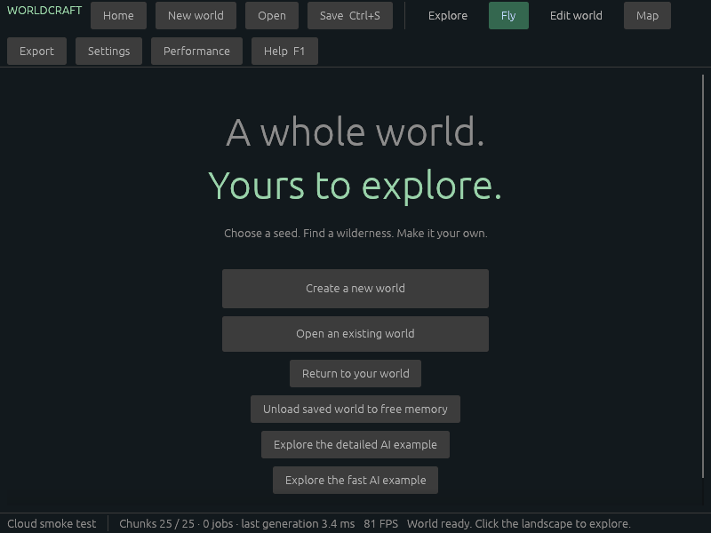

# Adaptive renderer audit

Updated 2026-11-16. Branch: `codex/worldcraft-adaptive-quality`. PR: #4, based on #3.
Status: engineering alpha candidate; not published or certified as the completed engine.

## 1. Evidence ledger

The first hosted snapshot is commit `c24a5098ba2cfe84c5e72887288cbfa873fb641c`, run
[43890874327](https://github.com/InduwaraLasindu/Worldcraft/actions/runs/43890874327).
Later hardening is distinguished below; results never automatically transfer to newer code.

| Check | Result | Exact scope |
|---|---|---|
| Latest local core + ML | Passed: 27 core unit + 28 world integration + 9 ML unit | Includes classifier/governor, parent grid/normal/color endpoints, negative coordinates and horizon joins across radii/observer offsets |
| Latest local desktop | Passed: 12 tests | Auto/manual/pressure policy, saved-world compatibility, collisions, editing and storage |
| Latest desktop API/all targets | Passed, ci profile | Native Rust/Bevy API compile; GPU shader compilation is a separate runtime check |
| First hosted Linux snapshot | Entire job passed | Native model inference, launch probe, Eco scene, idle process metrics, regular rendering, rebase/quality/world changes and captures |
| First hosted Windows snapshot | Compile/tests/native inference/rendering/image checks passed | Release executable, installer/portable preparation, WARP DX12 at 128×96; all eight image-variation checks completed |
| First Windows workflow final result | Failed after rendering | Optional evidence publisher required absent GH_TOKEN. Current script skips optional publication without credentials; artifacts remain uploaded |
| Final Windows packaged detailed example | Pending rerun | The publisher failure interrupted the later portable detailed-world step; do not call it passed |
| Hardened snapshot b98a9ee, Linux | Entire job passed, run 43897987803 | Explicit frustum witnesses, capped probe, software-tier floor, 50% automatic scene route and saved-world equality |
| Hardened snapshot b98a9ee, Windows | Compile/tests/inference/calibration passed; packaging in progress | Explicit front/rear culling and minimum automatic tier passed |
| Final small changes | Awaiting final queued run | Strict 30-FPS controller regression (76 local tests) and distinct Windows packaging-helper type name |
| Gaming-GPU FPS / VRAM | Unmeasured | No 30 FPS guarantee or broad gaming-hardware certification |

Clippy completed with existing style warnings in legacy code; no new core/controller
warnings were identified. Formatting and locked dependency checks passed.

## 2. Actual idle measurement

From hardened snapshot b98a9ee, at 640×360, after startup and over 10.01 seconds:

| Measurement | Observed value |
|---|---:|
| App CPU, logical cores used | 0.03897 |
| Equivalent percentage of one logical core | about 3.9% |
| App resident memory, start and observed peak | 324,624 KiB (about 317.0 MiB) |
| World camera active on Home | false |

This tracks the application process, not whole-system memory or CPU. It is one hosted
software-graphics fixture, not a guarantee for every computer. There is no measured
before/after baseline on the owner's PC.

## 3. Launch probe interpretation

The first Mesa software probe produced one post-warmup interval of about 3,642 ms and
10.25 ms of CPU terrain sampling, selecting tier 0 / 50% 3D resolution. The sample count
is insufficient for a reliable hardware score. The implementation deliberately uses a
conservative fallback below twelve samples; it must not display an invented confident FPS.

Later hardening caps probe width to 256 pixels for software adapters, 640 for constrained
machines and 1280 otherwise, preserving aspect ratio. Actual probe dimensions are recorded.
Software adapters are held at tier 0 even if exploration starts before calibration finishes.
The hardened software fixture recorded 93 intervals at 256×144 (p90 17.15 ms),
8.20 ms CPU sampling, front visible/rear culled, and tier 0. The real automatic scene
then rendered 400×300 beneath an 800×600 UI, with 25 chunks, no active jobs and unchanged
saved-world data. [Hardened measurements](evidence/adaptive-linux-hardened.json) contain
provenance. Live control is still necessary: a small synthetic fixture is not a complex
world performance prediction, and software rendering did not meet 30 FPS in the scene.

## 4. Saved visual evidence

[Raw measurements and provenance](evidence/adaptive-linux-initial.json) include source,
run/artifact identity, archive checksum and capture hashes. These are actual engine output,
not reference images or image-generated substitutes.

The visual gap to the owner's references remains large: richer materials/forests, rivers,
weather and cinematic composition require the later milestones. A successful software
render is not proof of reference-quality art or playable gaming-GPU performance.

## 5. Audit findings and hardening

- Kept old tiles until new budget replacements finish, avoiding a whole-landscape hole.
- Moved ground-cover geometry construction to workers and divided it into 32 m culling batches.
- Isolated the UI camera on render layer 30 so it does not visit world meshes for visibility;
  the native launch fixture remains isolated on layer 31.
- Added shared observer-driven position/normal/color morphing, including depth/shadow passes.
- Checked the first horizon collar against near-grid endpoints over view radii 2–12,
  negative world coordinates and several observer offsets.
- Added twelve-sample minimums, slow upward recovery and a two-percent frame-budget
  tolerance; sustained 29 FPS now lowers quality when targeting 30 FPS, or reports the
  minimum-quality limit. The additional regression brings local tests to 76.
- Manual Eco now bypasses launch calibration; the UI shows effective automatic settings
  and disables manual graphics/radius inputs while automatic tuning owns them.
- Added explicit front/rear visibility witnesses to the calibration audit and a scripted
  automatic floor render test at 50% scene resolution, leaving UI at native resolution.
- Completed far-job results are retired after unloading a world to release their retained mesh.
- Corrected the optional Windows evidence-publication path; enabled CI cache retention on
  failures so renderer issues do not force repeated dependency compilation. Renamed the
  detailed Windows helper to avoid a duplicate C# type when both packaging scripts run
  sequentially in one PowerShell session. The last helper change awaits the final run.

An exploratory local SwiftShader offscreen run produced valid scene pixels but timed out
at teardown; a combined quality sweep was killed by the host. That experiment was removed,
not counted as a passing full audit. The verified route is hosted Mesa/native Windows.

## 6. Remaining M1 checks and limits

- Confirm the final queued run, especially the corrected sequential Windows packaging
  checks and portable detailed example, before marking PR #4 ready or publishing packages.
  Run 43897987803 already passed Linux, Windows calibration and frustum witnesses.
- Verify scaled cursor picking interactively at 50/67/85/100%; the coordinate conversion
  is implemented, but no physical mouse interaction matrix has been certified.
- Capture camera routes across every topology threshold, including rapid flight/teleports,
  asynchronous late refinement and near/far rebakes. Endpoint equality does not certify
  every temporal transition. Vegetation still uses discrete representations.
- Experimental ray proxies are static CPU meshes; inspect their agreement with morphed
  raster geometry before claiming full ray-mode compatibility.
- Measure real Windows integrated/discrete GPUs, frame-time distributions and RAM/VRAM.
- Keep the alpha label. See ENGINE_PLAN.md for all remaining cinematic-world systems.
