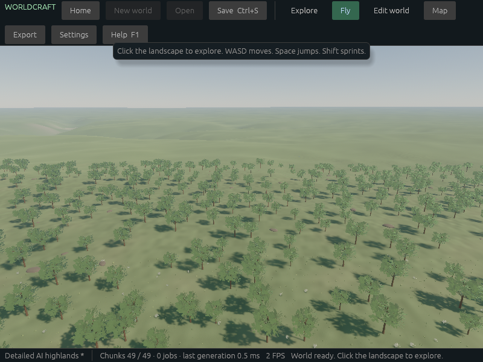

# Alpha 2 detailed-terrain audit

This milestone adds a finite native three-model Terrain Diffusion bake. It is an
engineering alpha, with the remaining scope tracked in [the feature matrix](../MASTER_SPEC_COVERAGE.md).

## Verified Linux product

Product source: `c04703b417cb01e5fb0994ed8fd739dbd2c80efa`.
[Successful hosted run](https://github.com/InduwaraLasindu/Worldcraft/actions/runs/43847671644).
All development, model downloads and execution took place on a standard hosted runner.

| Check | Observed result |
| --- | --- |
| Core, ML and desktop regression tests | 45 + 9 + 9 = 63 passed |
| Complete native detailed generations | Three: initial, repeated seed and changed seed |
| Same-seed maximum height difference | 0 m in this CPU fixture |
| Changed-seed mean absolute height difference | 95.569 m in this fixture |
| Saved detailed field | 320 × 320, 30 m spacing, 9,570 m width |
| Detailed elevation range | 24.336–351.813 m in this fixture |
| Coarse/detail join sampled across 2 mm | Maximum difference 0.000210 m; continuous transition |
| Cancellation during actual base refinement | Returned Cancelled; no replacement world was installed |
| Persistence | Exact world round trip and identical reopened samples |
| Editing | Sculpt, undo and reopened edited heights passed |
| Native scene | 800 × 600 software Vulkan; 49 resident chunks and 36,754 far-terrain triangles |
| Existing graphics regression | Low/Balanced/High, atmosphere, volumetrics, world switching, origin shift, maps, actual ray-query dispatch and raster cleanup passed |
| Detailed terrain GLB | Official Khronos validator: 0 errors, 0 warnings |
| Detailed terrain PNG | 16 bits; maximum decoded height error 0.0003733 m, within half a quantization step |
| Optional weights | Immutable revision, sizes and SHA-256 verified; 2,276,345,629 bytes total |
| Source/runtime | Native Rust and ONNX Runtime CPU; no Python/Java runtime shipped |

The suite loads the three models sequentially. Linux process peak resident high-water
measurement was about 4.65 GB during these tests. This is one fixture, not a universal
memory requirement or a performance guarantee. Model calls run away from the UI thread;
saved-world exploration runs no inference.

The final screenshot was visually inspected for visible terrain, procedural trees,
cast shadows, haze, holes and a blank viewport. The image below is actual application
output from software Vulkan. Its on-screen FPS is not a gaming-GPU benchmark.

Image SHA-256: `62953cc47fcc5af1b3087592e160a6ea174853bb2b433a55f353f96474d720d6`.

## Windows distribution

The separate frozen Windows audit is running:
[build and distribution run](https://github.com/InduwaraLasindu/Worldcraft/actions/runs/43852794308).

Publication waits for native model tests, Direct3D 12 checks, portable/installed runtime
validation, safe uninstall and visual review of a 640 × 360 capture from the actual ZIP.

## Practical limits

The new field is a central detailed region blended into coarse learned terrain and
classical surroundings. Infinite learned streaming, neighboring base-window ensembles,
WorldClim conditioning parity and GPU inference are unfinished. Hydrology, caves,
graphs, asset import, wind/weather, advanced ecosystems and cinematic tools remain
on the roadmap.

Software-rendered tests do not establish broad Windows UI, gaming-GPU performance,
driver coverage or production stability. The installer remains unsigned.
