# Native procedural biome captures

Executable source: `e21d5bcf11b0ec8d3621c8bd97ea5aafd934fe60`.
[Preview run](https://github.com/InduwaraLasindu/Worldcraft/actions/runs/44198247963).
All images are unedited 960 × 640 production-renderer captures. Hosted software
Vulkan verifies integration and appearance, not gaming-GPU speed. All eighteen
were inspected; the 80% reference-realism target remains unmet.

## Untouched worlds

The audit searches unpainted generator-3 worlds. Authored instances: **0**.
Each view settled at 25 resident chunks and zero queued jobs. Species counts,
coordinates, climate and normalized habitat weights are preserved in
[the provenance report](evidence/nature-e21d5bcf11b0ec8d3621c8bd97ea5aafd934fe60.json).

| Site | Seed | Habitat |
|---|---:|---|
| woodland | 42 | Forest |
| birch | 20261118 | BirchForest |
| savanna | 761 | Savanna |
| tropical | 279 | Rainforest |
| alpine | 324 | Conifer |
| meadow | 42 | Meadow |

### Woodland

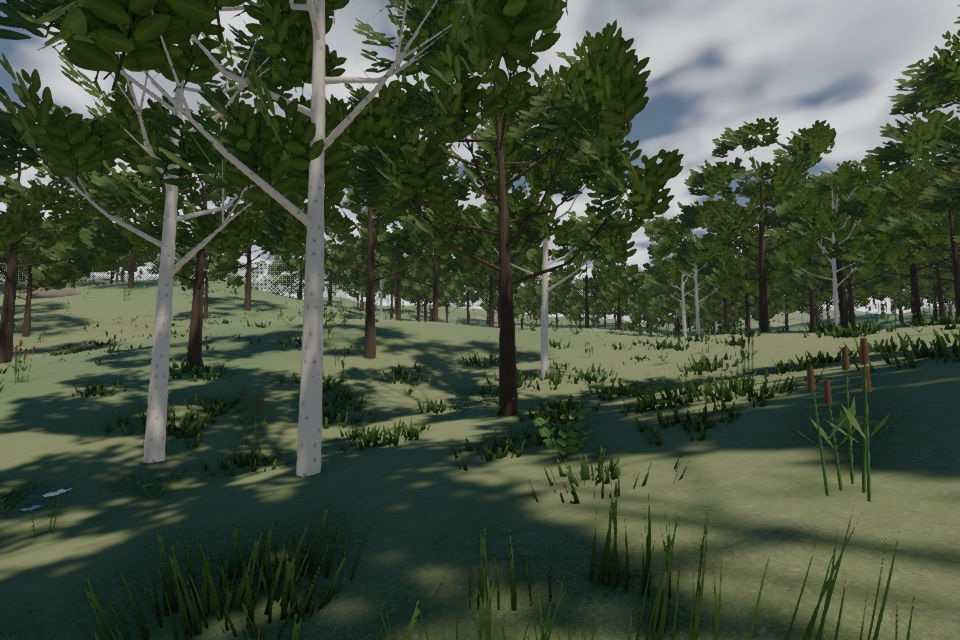

### Birch

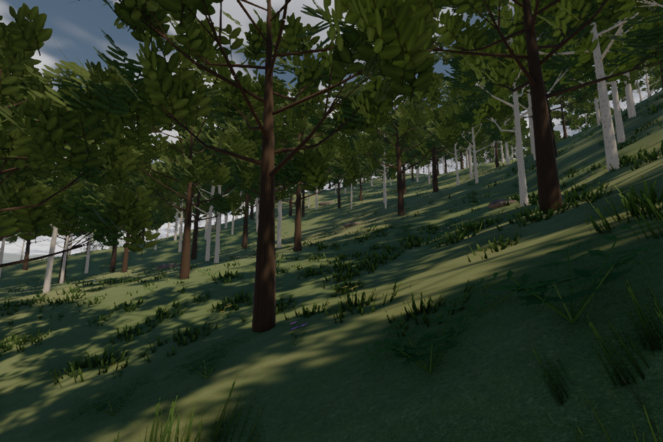

### Savanna

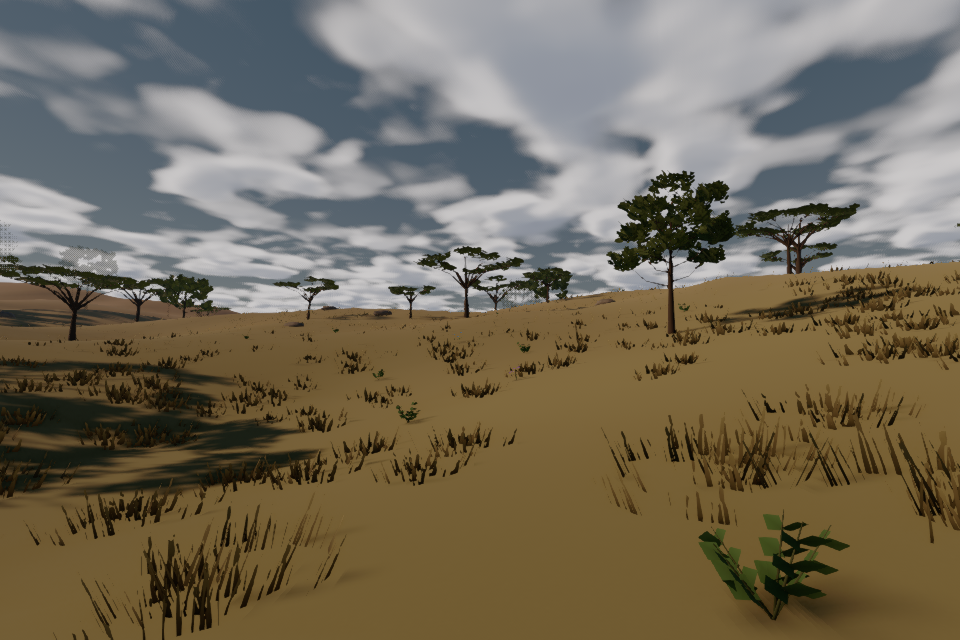

### Tropical

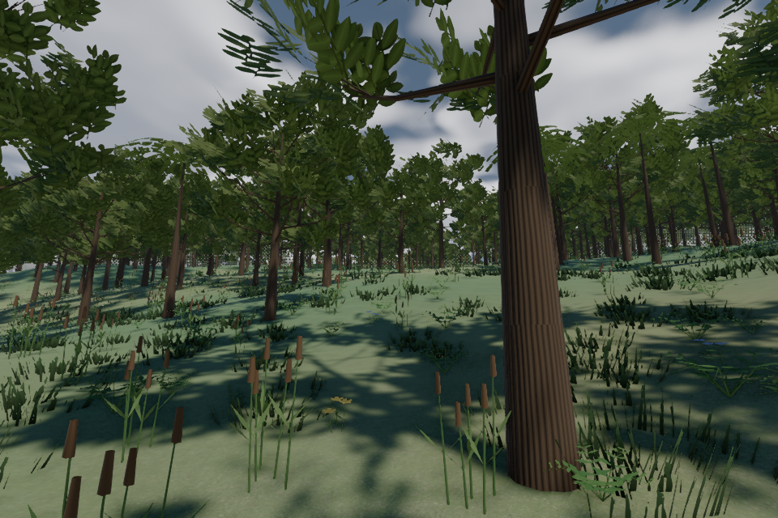

### Alpine

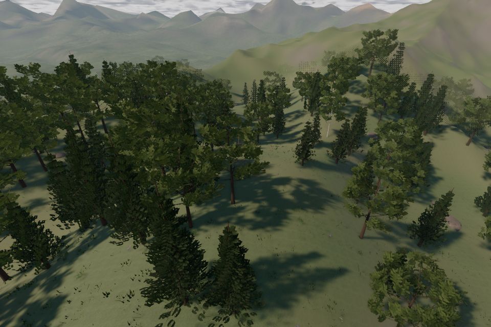

### Meadow

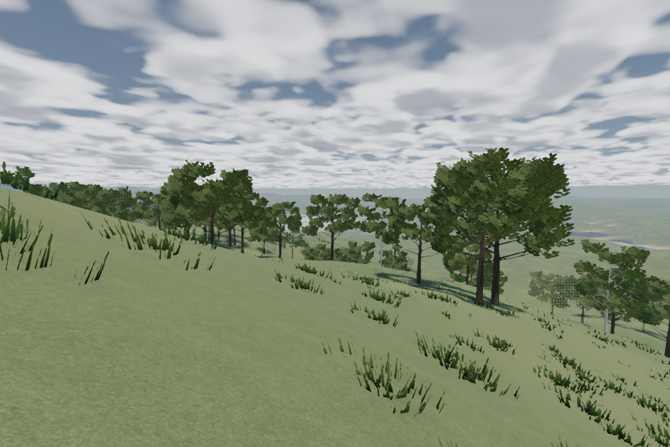

## Shared assets and quality checks

These fixtures deliberately place shared prototypes or use a known world camera.
They test assets, lighting, rebase and cloud toggles separately from procedural
ecosystems. Their authored placements do not certify natural ecology.

### broadleaf

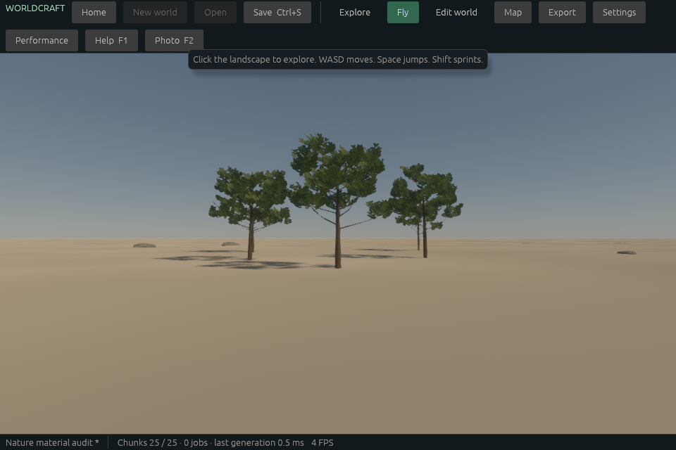

### pine

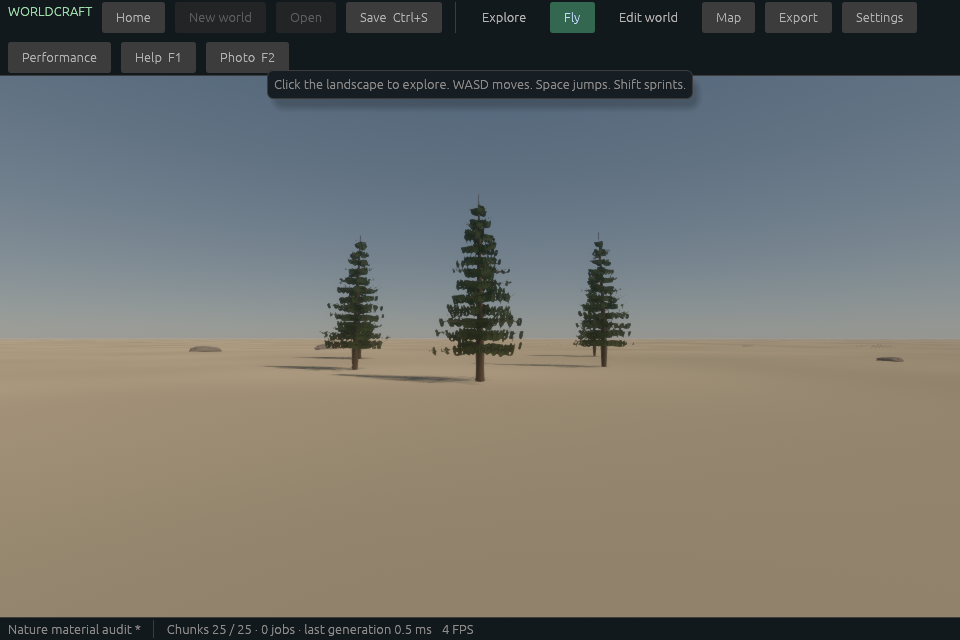

### palm

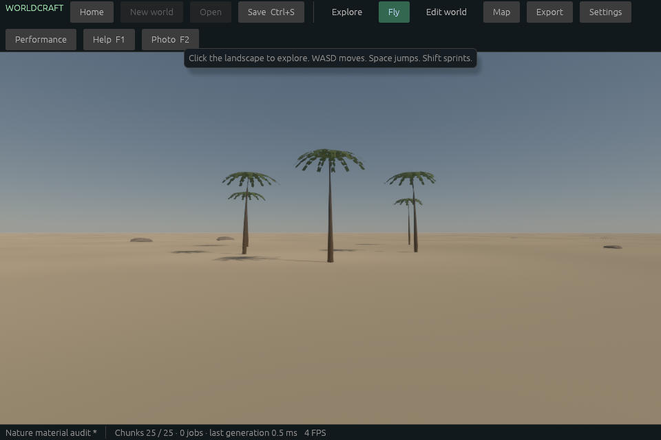

### bark

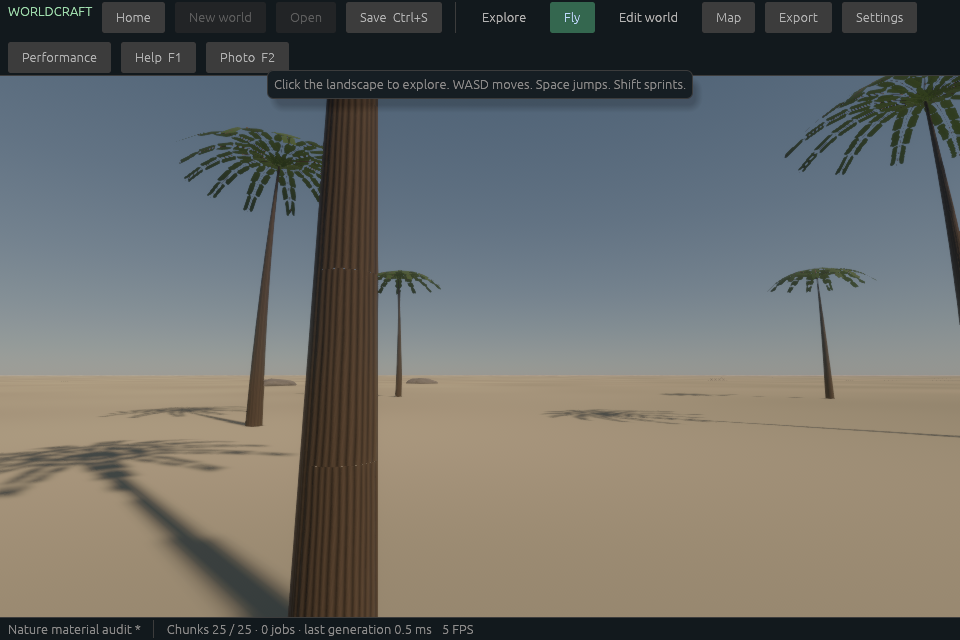

### coarse

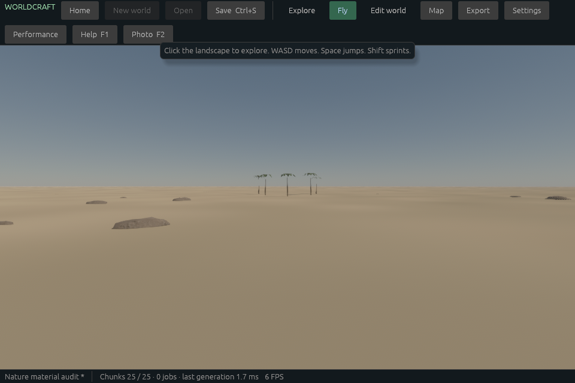

### rebase

### sunset

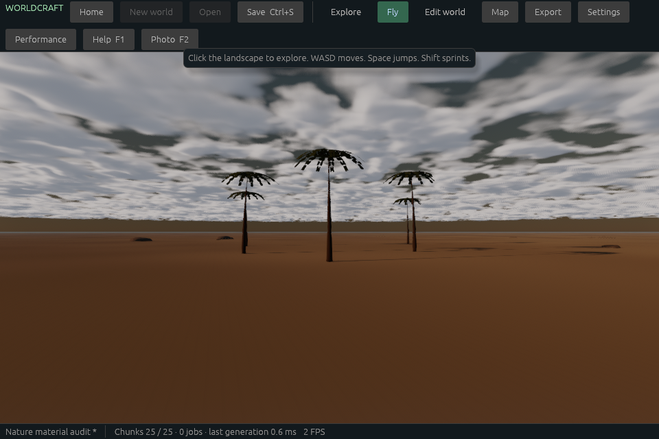

### forest-close

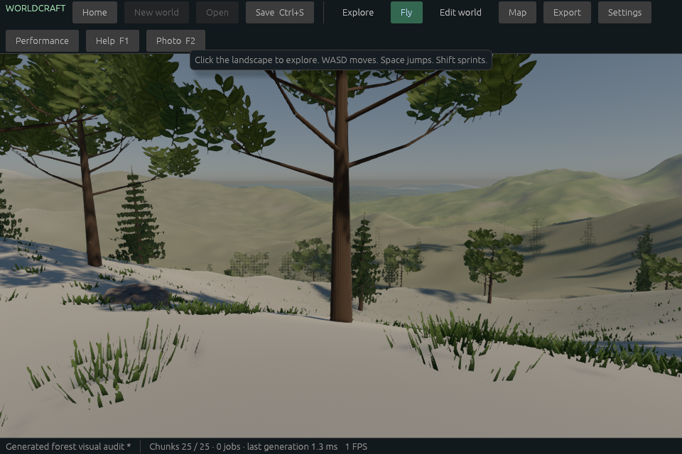

### forest-overlook

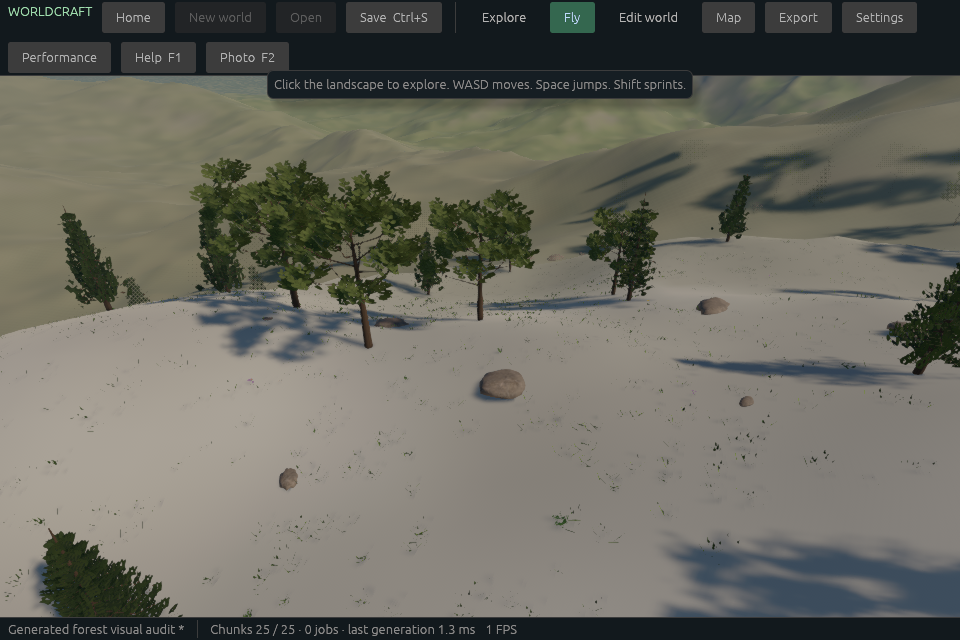

### forest-high

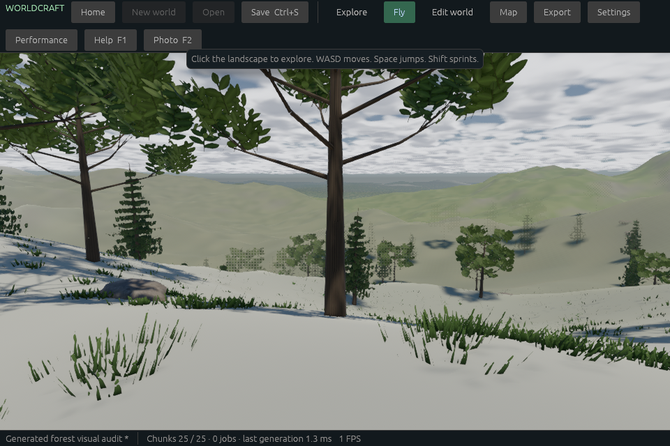

### clouds-clear

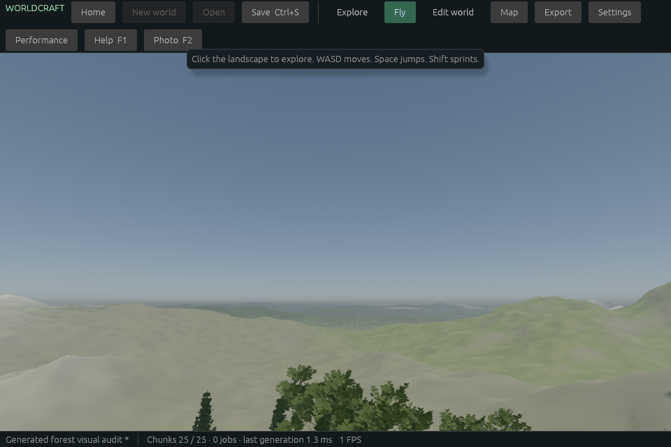

### clouds-high

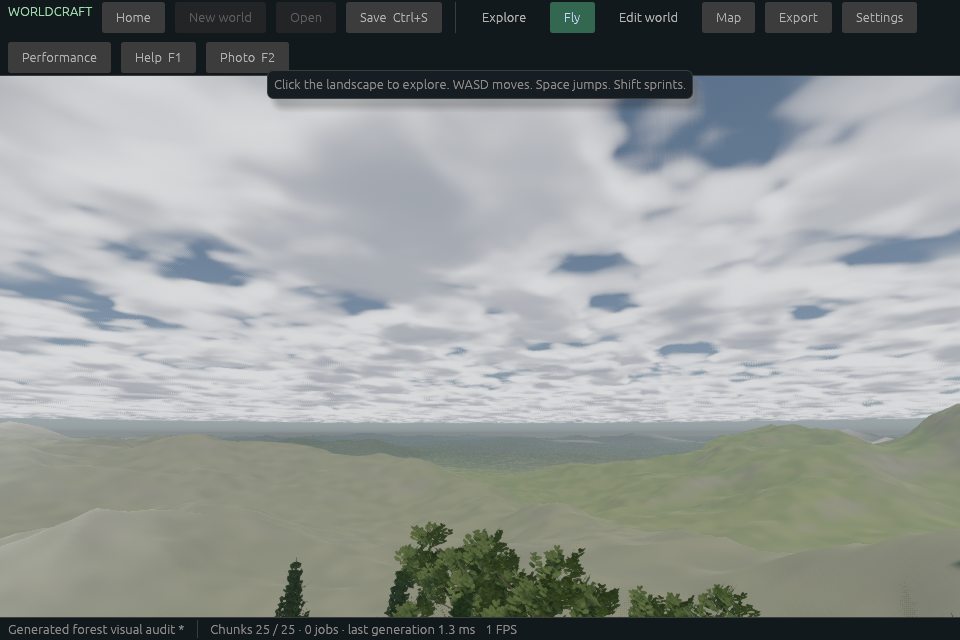

## Review result

Distinct biomes and open clearings are visible. Patchy understory, repeated/simple
leaf forms, checkerboard fades, bare far slopes and patterned clouds remain.
See [the audit](BIOME_AUDIT.md) for validation scope and the next acceptance work.
Resident mesh triangle totals include paired fine/coarse meshes; they are not
counts of visible GPU triangles or draw submissions.
