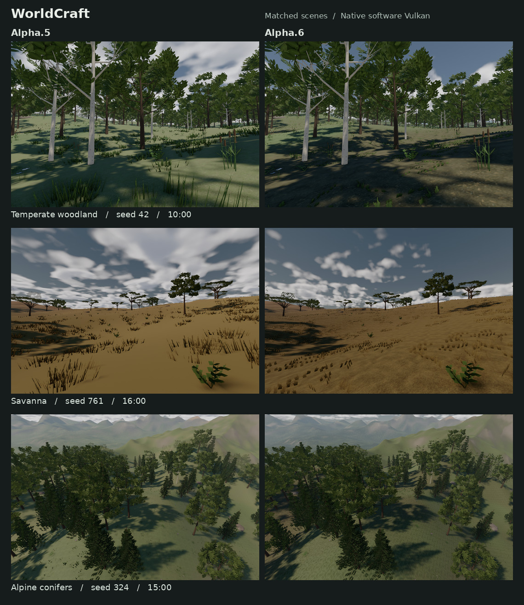

# Procedural landscape audit for alpha.6

Product commit `bd0288b09a74feaebe48dc17d7549875e4d76d1c` uses Bevy 0.20.1 and generator version 3. The comparison build is the published alpha.5 at `a58a3d45988fcb9bc1dea22a4a7cdbd3035aeebe`. Both runs use identical seeds, world coordinates, sun angles, output dimensions and zero wind for the six biome views. [Candidate checks](https://github.com/InduwaraLasindu/Worldcraft/actions/runs/44280142267) · [Previous captures](https://github.com/InduwaraLasindu/Worldcraft/blob/f0f860b380eb26d988623bc9f928b39f1b90c575/docs/RENDER_GALLERY.md)

The comparison uses ungraded native frames from the two releases. Only the thumbnails were resized. Full-size alpha.6 PNGs are available for [woodland](https://github.com/InduwaraLasindu/Worldcraft/releases/download/v0.2.0-alpha.6/worldcraft-biome-woodland.png), [birch](https://github.com/InduwaraLasindu/Worldcraft/releases/download/v0.2.0-alpha.6/worldcraft-biome-birch.png), [savanna](https://github.com/InduwaraLasindu/Worldcraft/releases/download/v0.2.0-alpha.6/worldcraft-biome-savanna.png), [tropical](https://github.com/InduwaraLasindu/Worldcraft/releases/download/v0.2.0-alpha.6/worldcraft-biome-tropical.png), [alpine](https://github.com/InduwaraLasindu/Worldcraft/releases/download/v0.2.0-alpha.6/worldcraft-biome-alpine.png) and [meadow](https://github.com/InduwaraLasindu/Worldcraft/releases/download/v0.2.0-alpha.6/worldcraft-biome-meadow.png).

## What changed on screen

- **Ground cover.** Grass spreads over a disk. Each end of each card sits on the same four-metre triangle grid used for walking. Three small clumps on each card carry curved blades with varying reach, pigment and height. A broad upward lighting response prevents a whole clump from going dark when its card faces across the sun. The flower, fern and reed lane retains opaque texels through its mip chain.
- **Distant trees.** Foliage clusters shrink around their individual centres and branches shrink toward their centrelines during the final 96 metres. Forward, shadow, depth and motion passes share the geometry. Climate, stand patterns, slope, water and vegetation brush edits control distant canopy shading. The same weights cross the terrain LOD boundary. A ridge beyond the geometric tree limit still has a terrain silhouette.
- **Surface materials.** The default terrain set uses original procedural albedo, normals and roughness. The build generates wrapped leaf litter, pebbles, grass blades and fractured rock from seeds. The previous Poly Haven set is available live under **Render settings → Terrain materials**. Both sets use three 512-square layers and ten mips. The two active arrays occupy 8,388,600 bytes in source pixel data. The executable embeds both sets. All four embedded map hashes in the packaged Windows executable matched the Linux release manifest. On a separate cloud CPU, two consecutive rebakes matched each other. Four of the 4,194,300 bytes in each color pack rounded one level differently from the release build. Both normal/roughness packs matched exactly.
- **Clouds.** A broad weather field changes the height and thickness of the layer. Erosion detail samples a different orientation and distant density softens into the horizon. High retains its 64-cubed noise texture, two solar probes per occupied sample and 16–48 primary samples. Low and Balanced use their previous sky paths.

## Published Windows build

[Download the test prerelease](https://github.com/InduwaraLasindu/Worldcraft/releases/tag/v0.2.0-alpha.6). The tag points to the tested product commit. The Linux, Windows and publication jobs all passed on [run 44280142267](https://github.com/InduwaraLasindu/Worldcraft/actions/runs/44280142267). [Release files, SHA-256 digests and capture provenance](evidence/alpha6-release.json).

- The Windows installer and portable archive passed their package checks. The extracted portable opened a learned world at 640 × 360, sculpted and undid an edit, saved it and reopened it with matching data. The per-user uninstall check preserved user data.
- Both platforms ran nine reconstruction/lens cases. Unsupported DLSS, DLAA and FSR requests correctly fell back to native rendering on the software devices. The 400 × 300 Windows WARP AA route reported a sampled peak of 848 MiB in process memory. This figure applies to this fixture alone.
- Linux ran a real software ray-query dispatch, returned to raster, and passed camera, Eco horizon, idle, materials, native AA and volumetric cloud checks. All 69 files in the public evidence archive matched the Linux job artifact byte for byte, including 49 original PNGs across all fixtures. The release exposes all six untouched biome PNGs as individual downloads.
- The comparison image was added after the product commit. Subsequent evidence and documentation updates did not change the executable. Earlier development runs were superseded while the material and canopy shaders were being revised.

## Ground mesh cost

Each grassy placement changed from 20 cards to 14, or 40 triangles to 28. The table counts all indexed ground-cover triangles, including the other plants, in the centre 128 m tile at the three camera sites. The generator admitted the same placements in each build.

| Site and seed | Ground plants | Alpha.5 triangles | Alpha.6 triangles | Reduction | Alpha.5 CPU | Alpha.6 CPU |
| --- | ---: | ---: | ---: | ---: | ---: | ---: |
| Temperate woodland, 42 | 1,777 | 122,890 | 108,262 | 11.9% | 10.28 ms | 10.29 ms |
| Savanna, 761 | 1,285 | 54,200 | 39,560 | 27.0% | 3.16 ms | 3.26 ms |
| Alpine, 324 | 1,585 | 84,960 | 68,724 | 19.1% | 6.78 ms | 5.79 ms |

CPU timing covers construction and anchoring of the existing 16 batches from a prebuilt terrain mesh and fixed scatters. Each result is the median of three alternating runs of 15 timed warm builds on one cloud CPU. The alpha.6 geometry measurements used the final 14-card layout before its material-only color, atlas and lighting edits. Startup, streaming, GPU drawing and frame times fall outside this measurement.

A separate cloud CPU sweep exercised 162 tiles across all nine presets, generator versions 1–3, two seeds and three signed coordinate pairs per combination. It built 60,110 ground plants and 2,796,697 indexed triangles. All positions and normals were finite. Fresh and reused terrain grids agreed at each tested tile boundary. Among 4,088 sampled boundary blade roots, the largest vertical difference from walking collision was 0.00006415 m.

Thirty-two live switches in a separate Bevy asset-lifetime test returned to the initial ten shared nature images after each switch. Twelve images briefly coexisted while the old pair was released. Every surface material bound the same active pair after each switch. This counts engine-side image assets. Physical VRAM and frame-time spikes during a switch remain unmeasured.

## Repeating the comparisons

Use `--biome-smoke-test` for woodland, birch, savanna, tropical, alpine and meadow. At the savanna camera the same run switches to scanned surfaces, waits for rendering, saves a second PNG and restores the procedural set. The ground-image check compares the lower third of these two views. The fixtures place zero authored objects.

Use `--forest-travel-test` to fly away from a real seed-42 woodland tree in two-metre steps. Captures at 92, 126, 130, 160, 192, 218, 226 and 248 metres span the 128 m crown switch and 224 m tree cutoff at this view radius. The audit checks camera position, presented images, terrain residency and pending work. Distance checks and changed pixels alone cannot establish that a transition is imperceptible.

## Exact-source native images

The Linux runner captured all six untouched biomes at 960 × 640 with Mesa 26.0.8 / llvmpipe Vulkan. Each frame settled with 25 terrain chunks and zero pending jobs. Seeds, camera transforms, lighting hours, biome weights and centre-tile species counts matched the alpha.5 records at all six sites. Switching materials at the fixed savanna camera changed 73.0% of pixels in the lower third by more than four 8-bit channel values. The flight peaked at 25 resident chunks and four queued jobs. Its eight frames show the transition into a largely smooth treeless ridge beyond the geometric tree limit.

The alpine image also permits a direct screen-pattern comparison. Across the full-width distant tree band (rows 80 through 239), the standard deviation of the sixteen mean 4 × 4 pixel phases fell from **1.145** to **0.075** in 8-bit luma units. The measurement subtracts a 1.5-pixel Gaussian blur before grouping by pixel phase. Bevy's old visibility dither repeats every four pixels. This measures a fixed screen pattern in this view. The flight frames still show thinning around the outer cutoff.

## Visual target

The owner's references show fine, irregular vegetation across the ground, complex bark, wooded skylines, layered light and reflective water bordered by rocks and plants. Grass clumps, tree bark and some crown silhouettes still repeat visibly. The far canopy needs actual silhouette depth, and the generator still has ocean water and analytic valley masks. Connected waterways, waterfalls and hydraulic erosion remain open. Neither the 80% nor the 100% reference-realism milestone is verified. Vendor execution, gaming FPS and VRAM require measurements on supported physical hardware.

### Art-direction estimate

My estimate for the six land views is **about 45/100** against the supplied daylight forest and wooded river-valley references. This is a single qualitative review. The new rubric gives equal weight to five visible features, with 0 for absent, 1 for basic representation, 2 for a recognizable result with conspicuous artifacts, 3 for a convincing result across the route and 4 for consistency with the references.

| Feature | Rating | Observation |
| --- | ---: | --- |
| Landforms | 2/4 | Elevation and ridges read at a distance. Far slopes lack the reference's rock structure and surface breakup. |
| Ground cover | 2/4 | Litter, turf and climate-specific plants are visible. Bare intervals and repeated clump spacing are conspicuous, particularly in meadow and savanna. |
| Trees and understory | 2/4 | Birch, conifers and acacias have distinguishable silhouettes. Crowns, stems and close bark repeat, and the tropical floor has little layering. |
| Forest depth | 1/4 | The outer checkerboard is gone. Large parts of distant wooded hills still have smooth terrain silhouettes. |
| Light and atmosphere | 2/4 | Trees cast readable shadows and clouds have varied thickness. The sky and distant haze lack the tonal depth of the references. |

The ratings total 9/20. The review covers land imagery. Waterways, interaction, frame pacing and overall specification completion need their own evidence. No comparison score was assigned retroactively to alpha.5.
