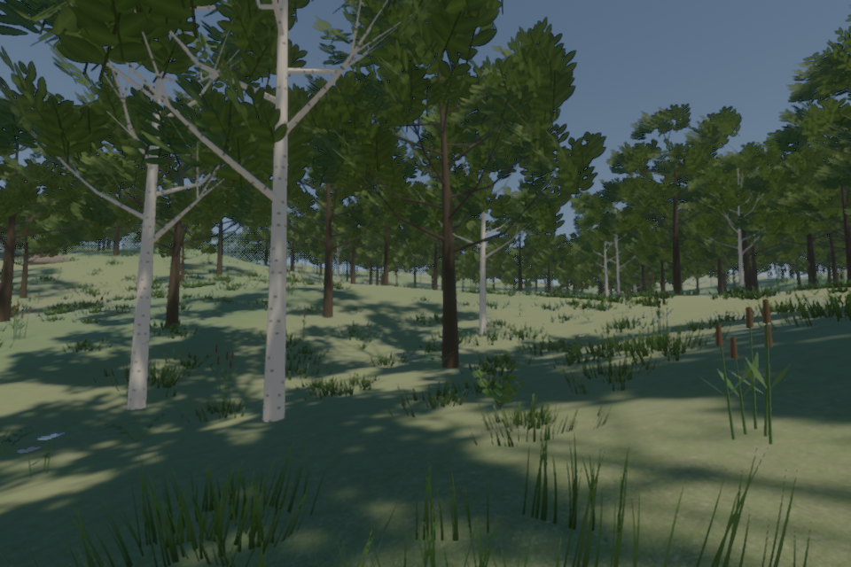
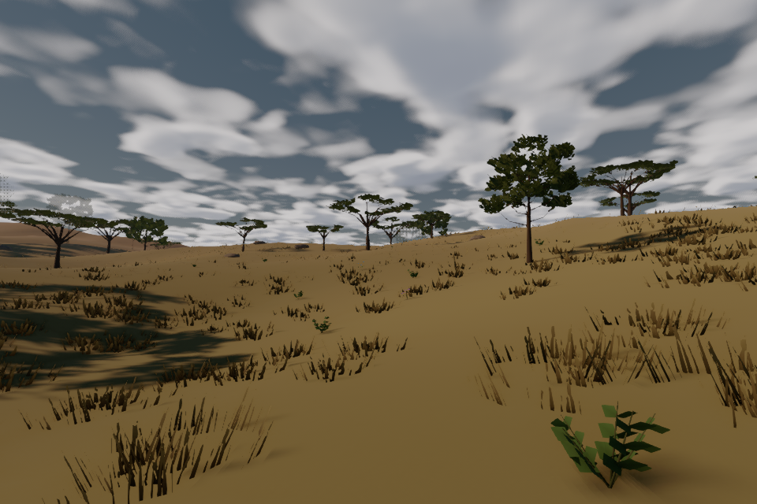
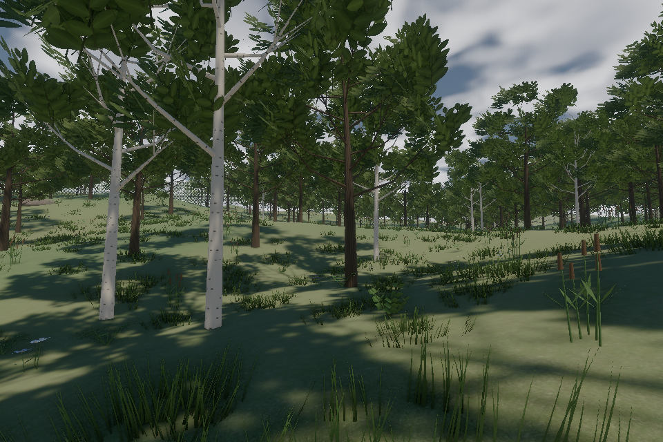

# Recent native WorldCraft screenshots

Source: c717fd17b79e9f4a7bf3fcdc4823d69a5c5081cf. [Passing Linux run](https://github.com/InduwaraLasindu/Worldcraft/actions/runs/44247596562).

Unedited 960 × 640 software Vulkan captures. The subsequent API-selection compatibility patch does not change the Vulkan shaders. These images are real application output; they do not establish AAA quality or vendor GPU execution. The 80% realism target remains unmet.

## Native TAA woodland

## Untouched savanna

## Untouched alpine

## Native depth-of-field case

