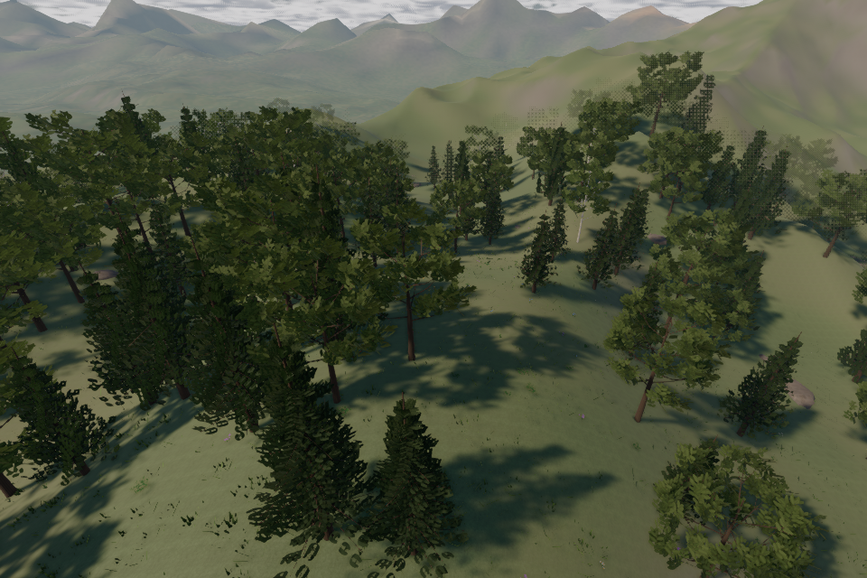

# Recent native WorldCraft screenshots

Source: a58a3d45988fcb9bc1dea22a4a7cdbd3035aeebe. [Passing Linux run](https://github.com/InduwaraLasindu/Worldcraft/actions/runs/44250142452).

Unedited 960 × 640 software Vulkan captures. These images are real application output; they do not establish AAA quality or vendor GPU execution. The 80% realism target remains unmet.

## Native TAA woodland

## Untouched savanna

## Untouched alpine

## Native depth-of-field case

